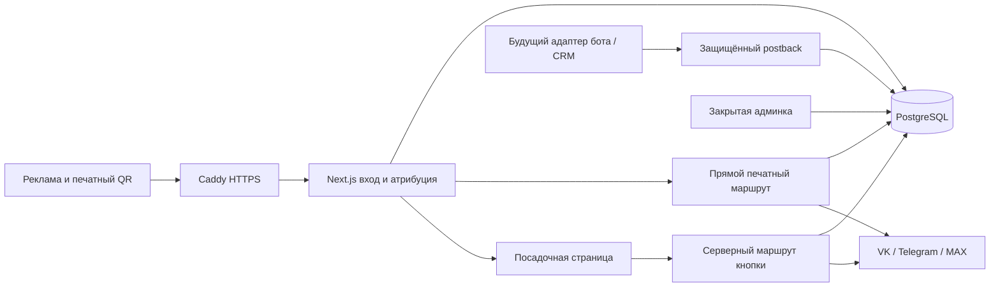

# Устройство системы

## Один сервер приложения и одна БД

Next.js App Router обслуживает серверную посадочную страницу, закрытый интерфейс управления и HTTP-маршруты. TypeScript-контракты общие для интерфейса и серверных сервисов. Tailwind и обычный CSS используются для оформления, без тяжёлой библиотеки анимаций. События регистрируются сервером до перенаправления; клиентский JavaScript и Яндекс.Метрика не являются обязательным звеном собственной статистики.

На VPS Caddy принимает HTTP/HTTPS, получает сертификат и передаёт запросы приложению внутри Docker-сети. PostgreSQL недоступен извне. У приложения нет открытого host-порта. Для локального запуска и тестов драйвер Drizzle переключается на PGlite; используется тот же SQL и схема. PGlite — однопроцессный локальный режим, производственный путь — PostgreSQL через `pg.Pool`.

Выпуск собирается `next build --webpack`; runtime запускает `next start`. Контейнер содержит полный набор зависимостей и исходники CLI, а не standalone-артефакт. Миграции запускаются явно отдельной командой перед обновлением приложения.

## Основные таблицы

| Таблица | Данные и назначение |
|---|---|
| `campaigns` | Постоянный UUID кампании, название, плановый бюджет, active/archived |
| `sources` | UUID, постоянный основной/печатный код, кампания, размещение, стоимость, UTM, индивидуальные ссылки, тестовый признак |
| `source_aliases` | Единое уникальное пространство кодов; ссылка на UUID источника |
| `settings` | JSON настроек, глобальных ссылок, категорий/площадок, черновика и опубликованного контента |
| `sessions` | Анонимный UUID, первый/последний источник и атрибуция, время создания/последней активности |
| `events` | Фактический тип события, источник/кампания на момент события, sessionId, соцсеть, качество и грубое устройство/браузер |
| `conversions` | Подтверждённые агрегированные результаты: origin, внешний ID, тип, количество, источник, необязательный clickId |
| `admins` | Email администратора и scrypt-хеш пароля; публичной регистрации нет |
| `admin_sessions` | SHA-256 идентификатора входа, CSRF-секрет и срок; сырой токен хранится только в cookie браузера |
| `rate_limits`, `dedup` | Короткоживущие ключи для атомарного ограничения и исключения быстрых повторов |
| `audit`, `link_history` | Критические административные действия и история конечных адресов |
| `schema_migrations` | Имя SQL-файла, checksum и время применения |

Источники не удаляются и их коды не переназначаются: отключение активности сохраняет напечатанный URL. Кампании архивируются. Основной и печатный коды нельзя менять после создания. Категории и площадки расширяются настройками, а не миграцией SQL enum. Нет программного лимита числа источников; таблица и выборки MVP ещё не имеют серверной пагинации, поэтому очень большие списки потребуют её добавления. Интерфейс аудита, истории ссылок и подтверждённых записей показывает последние 150 записей, хотя расчёт итоговых метрик использует весь выбранный период.

## Поток входа и клика

1. `/r/:code` разрешает код через `source_aliases`, нормализует UTM и определяет источник. Создаёт событие `incoming` и перенаправляет на `/` с подписанным краткосрочным контекстом `entry`.
2. Главная страница регистрирует `landing_view`. Валидный контекст входа позволяет не создавать второе `incoming` в той же цепочке. При обычном открытии главной без такого контекста записываются вход и просмотр.
3. Кнопка ведёт на `/go/vk`, `/go/telegram` или `/go/max` с подписанным контекстом. Сервер выбирает индивидуальную ссылку источника либо глобальную, снова проверяет HTTPS/домен, записывает `social_click` и отвечает перенаправлением.
4. `/v/:code`, `/t/:code`, `/m/:code` записывают `incoming` и `print_click`, затем ведут непосредственно в соцсеть. Они не создают `landing_view` и не поднимают конверсию лендинга.
5. В режимах `source/click` сервер добавляет платформенный параметр. Настоящий бот или CRM должны отдельно сообщить о подтверждённом результате; чтение сайта не доказывает подписку.

Серверный UUID клика можно передать внешней системе компактным `c_...` payload. При postback, связанном с кликом, кампания берётся из снимка события, поэтому последующий перенос источника в другую кампанию не переписывает атрибуцию этого клика. При подтверждении только по коду используется текущая кампания источника. События не копируют все поля источника: фильтры площадки, партнёра, категории и креатива используют текущую карточку. Для полного исторического версионирования этих измерений потребуется отдельная миграция.

Расходы также читаются из текущей карточки источника и не распределяются по дням. Бюджет кампании — план. Кампания события сохраняется исторически, но состав источников для расчёта её расходов — текущий: перенос источника между кампаниями не распределяет прошлые расходы. Для новой кампании после начала трафика создавайте отдельный источник. Для сложного финансового учёта нужна отдельная таблица затрат с датами.

## Атрибуция и сессии

Приоритет нового входа: явный существующий источник → нормализованные UTM → внешний домен referrer → direct. Произвольные UTM сохраняются в ограниченном объёме, но не создают источник. Сопоставление с карточкой допускается только для единственного подходящего настроенного набора UTM. Неоднозначное совпадение остаётся без sourceId. Полный referrer URL не сохраняется, только домен.

В рамках сессии first-touch фиксируется один раз. Last-touch меняется при новом рекламном входе; обычный внутренний переход не затирает его direct-источником. После 30 минут бездействия дальнейший вход создаёт новую сессию. Это не межустройственная идентификация и не долгосрочный профиль человека.

До согласия текущая цепочка страницы и кнопок связывается подписанным временным идентификатором в URL, без сохранения аналитической cookie. Такой идентификатор подписан HMAC, но не зашифрован; он не содержит ФИО или секрет интеграции. Подписанный URL может остаться в истории браузера; `Referrer-Policy` ограничивает передачу пути на внешние домены. Повторное открытие без исходного контекста получает новую сессию. Для рекламы следует распространять постоянный `/r/:code`, а не скопированный после открытия URL с временным контекстом.

После согласия cookie `motiv_session` связывает открытия браузера в 30-минутном окне. Выбор `motiv_consent` хранится до 180 дней и позволяет изменить решение через настройки приватности. Сессионная cookie HttpOnly, SameSite=Lax; Secure включается при HTTPS `APP_URL`. Административная cookie имеет HttpOnly, SameSite=Strict и срок 12 часов. Метрика загружается только после положительного выбора, без webvisor, clickmap и автоматического трекинга ссылок; собственные события от неё не зависят.

Аналитические сессии и серверные события есть и без аналитической cookie. Поэтому обещать отсутствие любой обработки до согласия неверно: правовое основание минимальной серверной статистики, состав и срок определяет владелец. Подробности в [чек-листе запуска](privacy-launch.md).

## Качество событий и отчёты

Сохраняется событие с `clean` и массивом причин исключения. Эвристики распознают известные ботоподобные User-Agent, предпросмотры, prefetch/prerender, HEAD, быстрые повторы и обращения без HTML Accept или режима document-навигации. В очищенный отчёт такие события не входят, в сыром режиме их можно увидеть. Предпросмотры не резервируют слот дедупликации настоящего открытия. Архивный источник продолжает работать и учитывать трафик: сам по себе статус не делает посетителя ботом. Это эвристическая квалификация, а не доказательство, что оставшийся трафик создан людьми; эти заголовки также могут быть подделаны, а необычный легитимный клиент — исключён.

Дедупликация использует атомарный ключ типа события, источника, соцсети и доверенного контекста с окном 5 секунд. Неподписанная произвольная cookie не становится доверенным идентификатором. Без валидной сессии применяется краткоживущий производный ключ технического адреса и User-Agent; полный IP/User-Agent в события не записывается. Публичные ограничения и dedup живут в общей БД и работают между экземплярами приложения. За Caddy принимается только настроенная доверенная цепочка адресов; при `TRUST_PROXY=false` локальные запросы разделяют технический ключ, что подходит для разработки, но ограничивает точность фильтрации.

«Сырые» — все события, принятые и сохранённые приложением, не все сетевые запросы к VPS. Запрос, отклонённый по частоте, неверному коду или до успешной записи, может отсутствовать в журнале событий. Запись аналитики находится в синхронном пути перехода: при недоступной БД приложение показывает ошибку, а не создаёт невидимую потерю счётчика.

Конверсия лендинга использует distinct sessionId с просмотром и хотя бы одним `social_click` в выбранном периоде и группе; сумма трёх соцсетей не используется как числитель. Прямые печатные клики входят в клики/расход на клик, но не в числитель конверсии лендинга. Подтверждённые результаты хранятся отдельно, доступны по типам; стоимость лида использует только тип `lead`. Фильтр устройства для подтверждений работает лишь при связанном клике — импортированному агрегату устройство не выдумывается.

Время событий — timestamptz, границы отчётного дня рассчитываются в выбранной IANA-зоне, по умолчанию Europe/Moscow. Тестовый признак копируется в события и подтверждения; обычный отчёт исключает тестовые данные. CSV использует те же фильтры, экранирование и защиту от выполнения формул. Выгрузка событий ограничена 100000 строками за раз; массовый QR — 100 источниками. В интерфейсе нулевая конверсия при нуле сессий не является доказательством отсутствия интереса, а стоимость с нулевым знаменателем остаётся без данных.

## Защита и обслуживание

Данные проверяет Zod на сервере, Drizzle/SQL используют связанные параметры; динамические SQL-имена выбираются сервером из закрытых вариантов. Редактируемый текст выводится React как текст, пользовательский HTML не исполняется. CSP ограничивает внешние источники, но допускает inline-скрипты Next.js; это не строгая nonce-based CSP. URL соцсетей имеют закрытый список HTTPS-хостов, запрещены userinfo, порт и известный внешний `away.php`-переход.

Пароли хешируются scrypt с индивидуальной солью. Административные записи требуют входа, точного Origin и CSRF-токена; вход имеет отдельный rate limit. Перенаправления не принимают произвольный пользовательский destination. Postback использует отдельный серверный Bearer-секрет, ограничение размера/частоты и уникальность `origin:externalId`. `origin` — канал приёма, не отдельный провайдер; разные боты/CRM обязаны включать свой префикс в ID. Повтор записи не обновляет результат.

Миграции имеют checksum и advisory lock. Очистка использует отдельную блокировку и удаляет истёкшие события, подтверждения, сессии и служебные ключи; сохранённые события сохраняют свои сессии для исторического CVR. По умолчанию подробная аналитика — 90 дней, аудит/история ссылок — 365. Истёкшая сессия не обязана удаляться немедленно: её строка нужна для оставшихся исторических событий. После удаления подробных событий постоянных агрегатов пока нет. Резервные копии очищаются отдельной политикой владельца.

## Развитие без смены рекламных URL

Первый этап масштабирования — серверная пагинация источников/аудита, мониторинг задержек и ошибок, подбор `DB_POOL_SIZE`, индексов и сроков. Затем несколько экземпляров приложения могут использовать одну PostgreSQL и одинаковый `AUTH_SECRET`: cookie, dedup и rate limit не привязаны к памяти одного процесса. Перед этим нужно проверить нагрузку на синхронную запись событий, прокси и соединения. Большой поток потребует партиционирования/агрегатов и, при необходимости, очереди с определённой политикой потерь; сейчас этого нет и предельная пропускная способность не измерена.

P2 расширяется миграциями:

- **Боты/CRM:** отдельные webhook-адаптеры проверяют подлинность платформы и отправляют существующий postback. Следующий шаг — таблица интеграций/ключей с provider scope, ротацией и журналом доставки; текущий общий секрет остаётся MVP.
- **Подписки:** сохранять только разрешённые и подтверждённые события платформы, с достаточной атрибуцией. Право чтения членства не появляется из одного рекламного клика.
- **Доход и ROMI:** добавить датированные затраты и доходы, валюту/статус/внешний ID, явно выбрать правила отнесения и периода. Текущие клики и подтверждения не превращать в фиктивный доход.
- **Роли:** добавить role/permission mapping к существующим администраторам и проверять разрешения на сервере для каждой мутации. Сейчас все созданные администраторы имеют одинаковые полномочия.
- **Долгая история:** до удаления подробных событий формировать обезличенные дневные агрегаты с документированной схемой. Миграция должна исключать повторный подсчёт и сохранять различие сессий, кликов и результатов.

Постоянный source UUID и неизменяемые алиасы позволяют добавлять эти механизмы, сохраняя ранее напечатанные адреса и QR.
